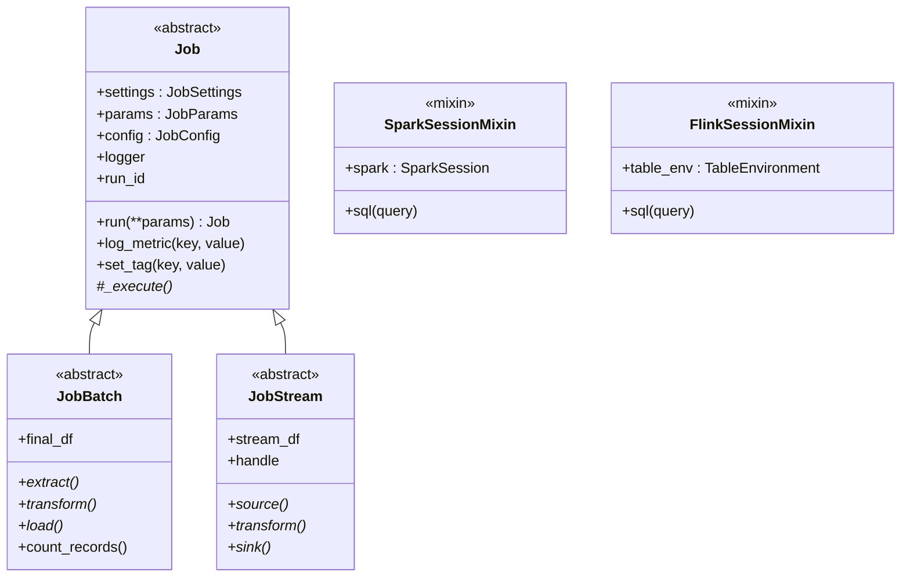
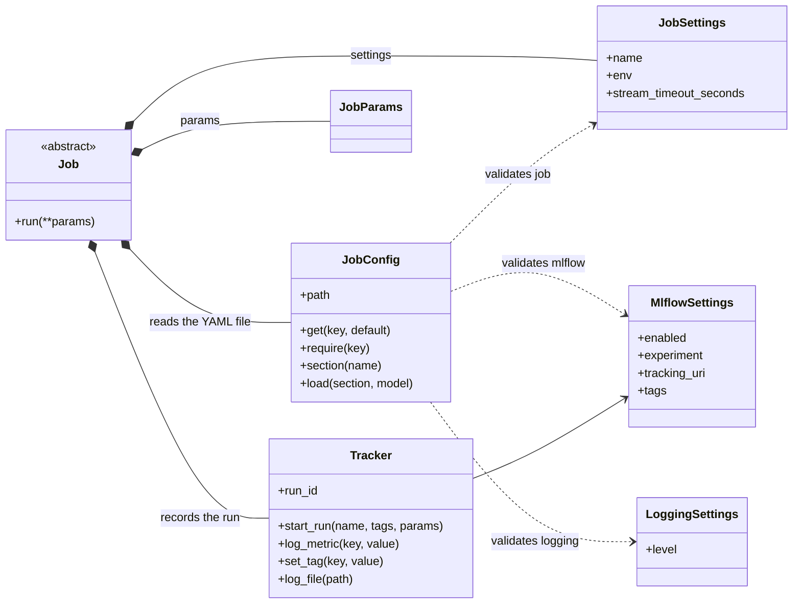
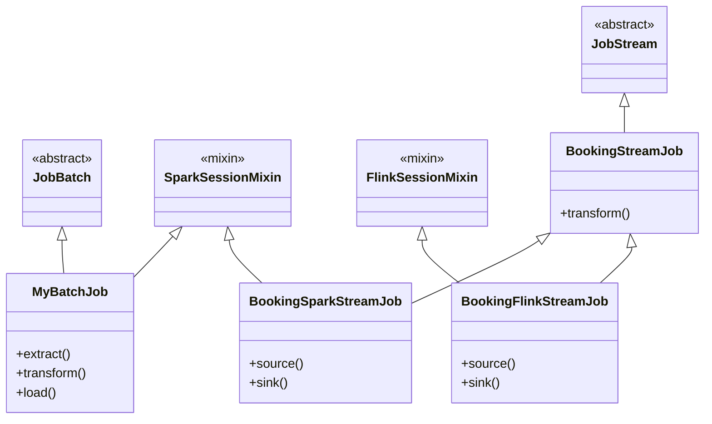
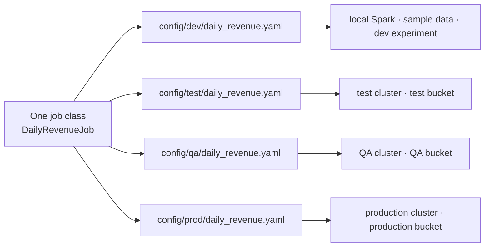

# PySpark ETL Boilerplate

A standard, configuration-driven framework for building data engineering
pipelines: batch or streaming, on Spark or Flink.

## What this is for

Every data pipeline needs the same scaffolding: a session, configuration,
logging, run tracking, error handling. When each pipeline writes its own, a team
ends up with as many styles as it has pipelines, and every new one starts from a
copy of an old one. This repository provides that scaffolding once, so that a
pipeline is only its business logic.

- **Standardised.** Every job has the same shape (`extract → transform → load`,
  or `source → transform → sink`), the same entry point and the same way of
  being configured, logged and tracked. Anyone on the team can open any job and
  know where to look.
- **Scalable.** The structure is the same for the first job and the fiftieth,
  for a laptop and a cluster, for batch and streaming, on Spark or Flink. Adding
  a pipeline means adding one class and one config file, not new plumbing.
- **Configuration-based, per environment.** A job contains no environment
  detail. Paths, cluster settings and tracking targets live in one YAML file per
  environment (`config/dev`, `test`, `qa`, `prod`), so the same code is promoted
  from one environment to the next by changing only `--conf`.
- **Observable by default.** Each run is recorded in MLflow with its
  parameters, timings, row counts, config and log, with no tracking code in the
  job.
- **Safe to change.** Settings and run parameters are validated before
  anything starts, and the framework and example jobs are covered by tests.

**Documentation:** this README is the overview. The full wiki is in
[`openwiki/`](openwiki/index.md): [quickstart](openwiki/quickstart.md),
[architecture](openwiki/architecture.md), [writing jobs](openwiki/writing-jobs.md),
[configuration](openwiki/configuration.md),
[tracking and logging](openwiki/tracking-and-logging.md),
[operations](openwiki/operations.md) and [training](openwiki/training.md).

---

## Architecture

### Core classes



A concrete job combines one mode with, optionally, one engine mixin:

The **mode** (batch or stream) is chosen by inheritance, the **engine** by a
mixin. `Job` itself has no engine, so a job that needs neither Spark nor Flink
simply leaves the mixin out:

```python
class DailyRevenueJob(SparkSessionMixin, JobBatch): ...    # Spark batch
class BookingStreamJob(SparkSessionMixin, JobStream): ...  # Spark Structured Streaming
class BookingFlinkJob(FlinkSessionMixin, JobStream): ...   # Flink streaming
class ApiExportJob(JobBatch): ...                          # plain Python
```

Sessions are lazy: nothing is imported or started until `self.spark` (or
`self.table_env`) is first used. `SparkSessionMixin` reuses the active session
when there is one (notebooks, Databricks) and otherwise builds one from the
`spark` section of the config.

### Configuration and tracking

`Job` delegates two concerns: `JobConfig` loads the YAML file and validates each
section into a typed model, and `Tracker` is the only class that talks to MLflow.



### Example jobs

How the jobs in `jobs/examples/` are assembled. The streaming example keeps the
transformation in an engine-neutral class and adds one thin subclass per engine.



### One job, one config file per environment



---

## Project structure

```
pyspark_etl_boilerplate/
├── main.py                     # Entry point: runs any job by its dotted path
├── pyproject.toml              # Version, dependencies, ruff and pytest settings
├── uv.lock                     # Exact dependency versions (managed by uv)
├── config/
│   ├── dev/                    # example.yaml, example_stream.yaml, training_*.yaml
│   ├── test/                   # example.yaml
│   ├── qa/
│   └── prod/
├── jobs/
│   ├── job.py                  # Job: run() template, MLflow, logging
│   ├── job_batch.py            # JobBatch
│   ├── job_stream.py           # JobStream
│   ├── settings.py             # JobSettings, JobParams: typed, validated (pydantic)
│   ├── config.py               # JobConfig: YAML loader with {placeholder} resolution
│   ├── tracking.py             # The only module that talks to MLflow
│   ├── logs.py                 # Console format and per-run log file
│   ├── sessions/               # SparkSessionMixin, FlinkSessionMixin
│   └── examples/               # MyBatchJob, BookingStreamJob (Spark and Flink)
├── utils/                      # DataFrame, date and file helpers
├── tests/                      # pytest suite
├── openwiki/                   # Documentation wiki (OpenWiki layout)
├── scripts/                    # CI helpers (documentation check)
├── .github/workflows/          # ci.yml (pull requests), release.yml (main)
├── data/                       # Sample data used by the examples and the training
└── training/                   # Databricks notebooks and slides (see training/README.md)
```

`etl/etl_interface.py` keeps the old `ETLInterface` name as a deprecated alias
of `SparkSessionMixin + JobBatch`.

---

## Quick start

```bash
uv sync                     # creates .venv with the locked dependencies

# Batch: CSV → cleaned Parquet
uv run python main.py --job jobs.examples.my_batch_job.MyBatchJob --conf config/dev/example.yaml

# Streaming on Spark: booking files → cleaned Parquet
uv run python main.py --job jobs.examples.booking_stream_job.BookingSparkStreamJob --conf config/dev/example_stream.yaml

# The same streaming job on Flink (uv sync --extra flink)
uv run python main.py --job jobs.examples.booking_stream_job.BookingFlinkStreamJob --conf config/dev/example_stream.yaml

# See the tracked runs
uv run mlflow ui
```

The dev examples read from `data/` and write to `output/`. Run
parameters are passed with `--param`, repeatable:

```bash
uv run python main.py --job my_package.my_module.MyJob --conf config/dev/my_job.yaml --param run_date=2016-03-15
```

---

## Writing a job

### Batch

```python
from datetime import date

from jobs import JobBatch, JobParams, JobSettings, SparkSessionMixin


class DailyRevenueJob(SparkSessionMixin, JobBatch):

    class Settings(JobSettings):          # keys this job needs in the `job` config section
        source_path: str
        target_path: str
        partition_by: list[str] = []

    class Params(JobParams):              # what changes on every run
        run_date: date

    def extract(self):
        self.df = self.spark.read.parquet(self.settings.source_path)

    def transform(self):
        self.final_df = self.df.filter(self.df["date"] == self.params.run_date)

    def load(self):
        self.final_df.write.mode("overwrite").parquet(self.settings.target_path)
        self.log_metric("days_processed", 1)            # optional custom metric


DailyRevenueJob("config/dev/daily_revenue.yaml").run(run_date="2016-03-15")
```

`Settings` and `Params` are [pydantic](https://docs.pydantic.dev) models. They
are optional, but declaring them gives you:

- **Fail-fast validation.** A missing `target_path` raises `ConfigError` when the
  job is created, before Spark starts; `run(run_date="oops")` is rejected before
  the run begins. The message names the field.
- **Typed values.** `self.params.run_date` is a `date`, `self.settings.partition_by`
  a list, with defaults where you set them.
- **A readable contract.** The top of the class says what the job needs.

Keys you do not declare remain readable (`self.settings.anything`).

### Stream

```python
from jobs import JobSettings, JobStream, SparkSessionMixin


class BookingStreamJob(SparkSessionMixin, JobStream):

    class Settings(JobSettings):
        source_table: str
        target_table: str
        checkpoint_path: str

    def source(self):
        self.events = self.spark.readStream.table(self.settings.source_table)

    def transform(self):
        self.stream_df = self.events.filter("AMT_Travel IS NOT NULL")

    def sink(self):
        return (self.stream_df.writeStream
                .option("checkpointLocation", self.settings.checkpoint_path)
                .trigger(availableNow=True)
                .toTable(self.settings.target_table))
```

`source()`, `transform()` and `sink()` only describe the pipeline. `sink()`
starts it and returns the running handle; `JobStream` then waits on it until the
stream ends or `job.stream_timeout_seconds` elapses.

### One streaming job on Spark or Flink

`JobStream` works with either engine. What is portable between them is the
transformation, when it is written in SQL: both session mixins expose
`self.sql(query)`. Sources and sinks are connectors, which are engine-specific,
so each engine gets a thin subclass. `jobs/examples/booking_stream_job.py` shows
the pattern:

```python
class BookingStreamJob(JobStream):                 # engine-neutral
    def transform(self):
        self.stream_df = self.sql(CLEAN_BOOKINGS)  # same SQL on both engines

class BookingSparkStreamJob(SparkSessionMixin, BookingStreamJob):
    def source(self): ...                          # spark.readStream → temp view `bookings`
    def sink(self): ...                            # writeStream → Parquet

class BookingFlinkStreamJob(FlinkSessionMixin, BookingStreamJob):
    def source(self): ...                          # CREATE TABLE bookings WITH (connector...)
    def sink(self): ...                            # execute_insert → CSV
```

The engine is chosen with `--job`; the config file is the same. A test checks
that both produce identical rows. Per-batch row counts are reported to MLflow on
Spark only; a Flink run records its Flink job id.

### What every step can use

| Inside a step | What it gives you |
|---|---|
| `self.settings.<key>` | a validated value from the `job` config section |
| `self.params.<name>` | a validated value passed to `job.run(name=...)` |
| `self.config.get("section.key", default)` | any other config value, with its YAML type |
| `self.logger` | a standard Python logger, stored with the run |
| `self.log_metric(key, value)` / `self.set_tag(key, value)` | tracking on the current MLflow run |
| `self.spark` / `self.table_env` / `self.sql(query)` | the engine session, when a mixin is used |

After a run, `job.run_id` is the MLflow run id and `job.final_df` the result.

---

## Configuration

One YAML file per job and environment. Values keep their type (booleans,
numbers, lists). The `job`, `mlflow` and `logging` sections are validated when
the job is created; a typo such as `experimnt:` is rejected.

```yaml
job:
  name: DailyRevenueJob            # optional; defaults to the class name
  env: dev
  source_path: "{bucket}/bookings"
  target_path: "{bucket}/daily_revenue"
  partition_by: [country, year]
  # stream_timeout_seconds: 60     # JobStream only: stop after this long

# Keys in `storage` and `database` can be used as {placeholders} in any value.
storage:
  bucket: s3://my-data-bucket

database:
  host: localhost
  port: 5432
  dbname: my_database

# Passed as-is to the SparkSession builder.
spark:
  spark.app.name: DailyRevenueJob
  spark.master: "local[*]"
  spark.sql.shuffle.partitions: 8

# Passed as-is to the Flink TableEnvironment (FlinkSessionMixin only).
flink:
  parallelism.default: 1

mlflow:
  enabled: true                    # false turns tracking off without touching the job
  experiment: DailyRevenueJob-dev
  tags: {team: data-eng}           # optional, added to every run

logging:
  level: INFO
```

A missing file, invalid YAML, an invalid value or a missing required key raises
`ConfigError` with the file and field name. Credentials do not belong in these files: the MLflow
server is taken from the `MLFLOW_TRACKING_URI` environment variable (already set
on Databricks; MLflow falls back to a local store in the working directory when
it is absent).

Where a Spark session already exists, cluster-level settings such as
`spark.master` are ignored and only runtime settings are applied.

---

## What is tracked

`Job.run()` records every execution as one MLflow run:

| Type | Key | Value |
|---|---|---|
| Tag | `job`, `mode`, `engine` | job name, `batch` / `stream`, `spark` / `flink` / `python` |
| Tag | `error` | exception type and message, on failed runs |
| Param | `env` | `job.env` |
| Param | *run parameters* | everything passed to `run(**params)` |
| Metric | `duration_seconds` | total run time |
| Metric | `<step>_seconds` | time spent in each step |
| Metric | `record_count` | rows produced (batch) or read (stream) |
| Metric | `batch_input_rows`, `batch_count` | per micro-batch, Spark streaming only |
| Artifact | `config/` | the config file used |
| Artifact | `logs/run.log` | everything the job logged during the run |

A step that raises marks the run `FAILED`, stores the traceback in the log
artifact and re-raises. Querying MLflow by `params.run_date` and `status` is
therefore enough to find gaps and backfill them (see training notebook 04).

Two limits: the log artifact contains the Python driver logs only, not Spark
executor or JVM logs, and it is uploaded when the run ends, so a long-running
stream is monitored live through the platform's own logs.

Because Spark is lazy, `extract_seconds` and `transform_seconds` are usually
close to zero: the work happens in `load()`. Counting rows runs the query once
more; set `track_record_count = False` on a job where that is too expensive.

---

## Development

Dependencies are managed with [uv](https://docs.astral.sh/uv/) and declared in
`pyproject.toml`; `uv.lock` pins the exact versions.

```bash
uv sync                            # core + dev dependencies, in .venv
uv sync --extra flink              # also install PyFlink
uv run pre-commit install          # run the checks on every commit
uv run pre-commit run --all-files  # run them on everything now
uv run pytest
uv add <package>                   # add a dependency (updates pyproject.toml and uv.lock)
```

The pre-commit hooks lint and format with [ruff](https://docs.astral.sh/ruff/)
(configured in `pyproject.toml`), run basic file checks (YAML and TOML syntax,
trailing whitespace, merge-conflict markers, large files) and check that
`uv.lock` matches `pyproject.toml`. The training notebooks, the sample data and
the slide deck are skipped.

The Spark tests need Java; the Flink tests are skipped unless PyFlink is
installed.

### CI and releases

Every pull request runs `.github/workflows/ci.yml`:

1. **Pre-commit**: the hooks above.
2. **Unit tests**: the pytest suite with Spark and Flink, once pre-commit passes.
3. **Version**: fails if the `version` in `pyproject.toml` was already released.
4. **Documentation**: fails if code changed without a documentation change.

### Documentation

The wiki in `openwiki/` follows the layout of
[OpenWiki](https://docs.langchain.com/oss/openwiki/overview): one Markdown page
per topic, with front matter, listed in `openwiki/index.md`. A pull request that
changes `jobs/`, `utils/`, `etl/`, `config/` or `main.py` must also change
`README.md` or a page under `openwiki/`; `scripts/check_docs_updated.py` enforces
it in CI. Edit the pages by hand, or refresh them with `openwiki --update`
(`npm install -g openwiki`, needs a model provider API key).

Every merge to `main` is a release. `.github/workflows/release.yml` tags the
commit `v<version>` and publishes a GitHub release with generated notes. The
version comes from `pyproject.toml`, so each pull request bumps it:

```bash
uv version --bump patch            # or minor / major; then commit pyproject.toml and uv.lock
```
