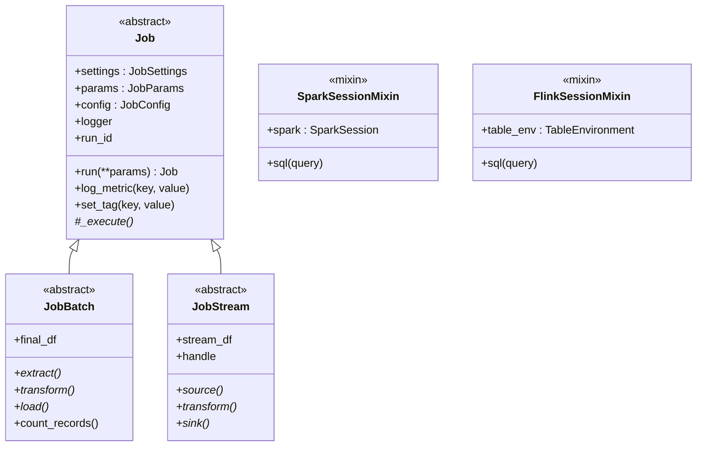
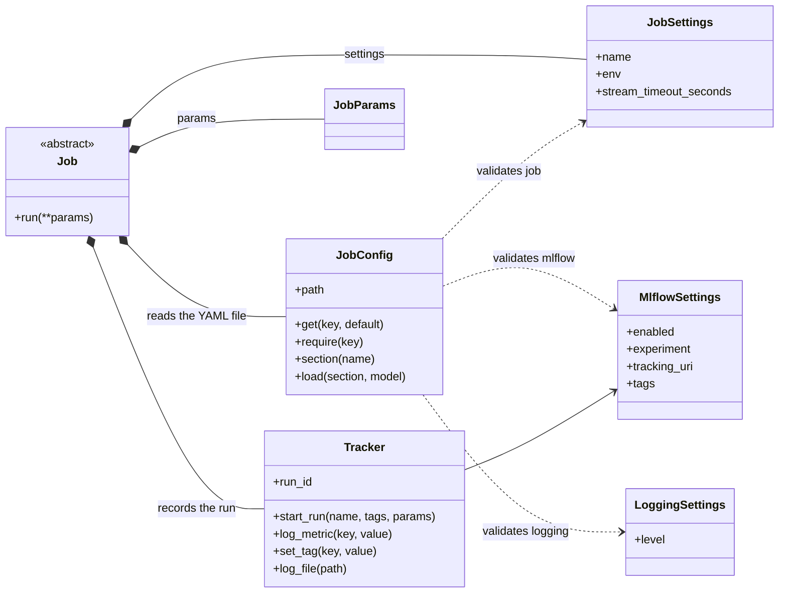
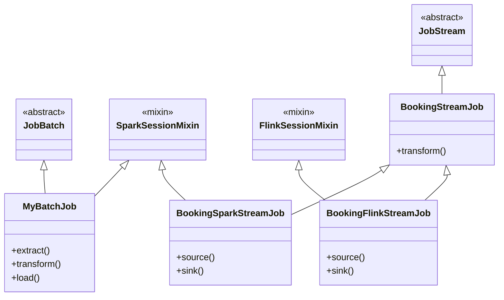

# Architecture

The framework exists so that every pipeline has the same shape and contains
only its business logic. The diagrams below show the classes that make that
possible.

## Core classes



## Two independent choices

| Choice | How it is made | Options |
|---|---|---|
| **Mode** | inheritance | `JobBatch` (bounded) or `JobStream` (unbounded) |
| **Engine** | mixin | `SparkSessionMixin`, `FlinkSessionMixin`, or none |

Both engines do both modes, so making the engine a mixin avoids one base class
per combination. `Job` itself has no engine: a job that calls an API or uses
pandas simply leaves the mixin out.

```python
class DailyRevenueJob(SparkSessionMixin, JobBatch): ...     # Spark batch
class BookingStreamJob(SparkSessionMixin, JobStream): ...   # Spark Structured Streaming
class BookingFlinkJob(FlinkSessionMixin, JobStream): ...    # Flink streaming
class ApiExportJob(JobBatch): ...                           # plain Python
```

## What `Job.run()` owns

`run()` is a template method. Subclasses provide the steps; `run()` provides
everything around them, in one place:

1. validates the run parameters into `self.params`;
2. opens the MLflow run and logs tags, parameters and the config file;
3. calls `_execute()`, which runs the steps and times each one;
4. on an exception, marks the run `FAILED`, records the error and re-raises;
5. always logs the duration and attaches the run's log file.

A concrete job therefore never imports `mlflow` or configures `logging`.

## Configuration and tracking

`Job` delegates two concerns. `JobConfig` loads the YAML file and validates each
section into a typed model. `Tracker` is the only class that talks to MLflow.



## Example jobs

How the jobs in `jobs/examples/` are assembled. The streaming example keeps the
transformation in an engine-neutral class and adds one thin subclass per engine.



## Sessions are lazy

Nothing is imported or started until `self.spark` or `self.table_env` is first
used, so a job can be created and its config validated without the engine.
`SparkSessionMixin` reuses the active session when there is one (notebooks,
Databricks) and otherwise builds one from the `spark` config section. On an
existing session only runtime settings are applied; cluster-level ones such as
`spark.master` are ignored.

## Modules

| Module | Responsibility |
|---|---|
| `jobs/job.py` | `Job`: the `run()` template |
| `jobs/job_batch.py`, `jobs/job_stream.py` | the two lifecycles |
| `jobs/sessions/` | the Spark and Flink mixins |
| `jobs/settings.py` | pydantic models: `JobSettings`, `JobParams`, `MlflowSettings`, `LoggingSettings` |
| `jobs/config.py` | `JobConfig`: YAML loading, placeholders, validation errors |
| `jobs/tracking.py` | the only module that talks to MLflow |
| `jobs/logs.py` | console format and the per-run log file |
| `jobs/examples/` | runnable example jobs |
| `main.py` | command-line entry point |

`etl/etl_interface.py` keeps the former `ETLInterface` name as a deprecated
alias of `SparkSessionMixin + JobBatch`.
