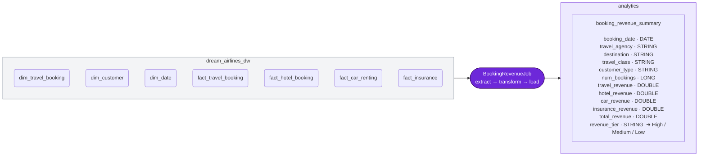

# DreamAirlines — Data Engineering Training

> This folder contains the hands-on training material for this repository.
> It is intentionally kept separate from the production ETL boilerplate so
> the two can evolve independently. Think of it as the flight simulator
> before you take the controls of the real aircraft.

---

```
Good morning, Agent.

Your target: DreamAirlines — a Portuguese travel agency running three offices
in Lisbon, Porto and Faro. Their data is scattered across 14 source tables
covering flights, hotels, car rentals and insurance. Nobody has ever joined
them together. The analytics team is flying blind.

This is your first data engineering assignment.
Your mission, should you choose to accept it, is to ingest the raw data,
expose its flaws, and deliver a clean, consolidated revenue pipeline that
the business can actually trust.

The source files are in data/dreamAirlines_DW/.
The Spark cluster is standing by.
This README will not self-destruct — but it will hold you accountable.

Good luck.
```

---

## What is this training about?

This is an applied illustration of the ETL boilerplate defined in this
repository. Every pattern you use here — `JobBatch`, `JobStream`,
`SparkSessionMixin`, the YAML config, MLflow tracking — maps directly to a real
file in `jobs/`. The exercises are designed to be your reference point the first
time you build a production job on top of this framework.

By the end you will have built a working daily ETL pipeline, profiled real
data quality issues, written the same transformation twice (SQL then DataFrame
API), used MLflow to detect and recover from simulated pipeline failures, and
turned a batch job into a streaming one that only processes new data.

---

## The data

DreamAirlines operates a classic star schema data warehouse covering
**October 2015 to September 2018**. The raw CSV files live in
`data/dreamAirlines_DW/` and are loaded into Delta tables by notebook `00`.

### Dimensions

| Table | Rows | What it describes |
|---|---|---|
| `dream_airlines_dw.dim_travel_booking` | 99 | Core booking — origin, destination, class, dates |
| `dream_airlines_dw.dim_customer` | 99 | Customer master — name, type, nationality |
| `dream_airlines_dw.dim_employee` | 15 | Staff across the three agencies |
| `dream_airlines_dw.dim_travel_agency` | 3 | Lisbon, Porto, Faro offices |
| `dream_airlines_dw.dim_hotel` | 21 | Hotel properties by country |
| `dream_airlines_dw.dim_car` | 25 | Vehicle inventory by rental company |
| `dream_airlines_dw.dim_insurance` | 6 | Insurance products (Standard / Plus / Full / Basic) |
| `dream_airlines_dw.dim_hotel_booking` | 83 | Hotel booking details |
| `dream_airlines_dw.dim_car_renting` | 88 | Car rental details |
| `dream_airlines_dw.dim_date` | 10 958 | Full calendar dimension 2000–2029 |

### Facts

| Table | Rows | Revenue column |
|---|---|---|
| `dream_airlines_dw.fact_travel_booking` | 99 | `AMT_Travel` |
| `dream_airlines_dw.fact_hotel_booking` | 83 | `AMT_Accomodation` |
| `dream_airlines_dw.fact_car_renting` | 88 | `AMT_Rental`, `AMT_DailyRate` |
| `dream_airlines_dw.fact_insurance` | 155 | `AMT_Travel_Insurance`, `AMT_Car_Insurance` |

---

## Target: what you will build



---

## The notebooks — run them in order

| # | Notebook | What you do | Share? |
|---|---|---|---|
| `00` | `00_setup_data` | Load all 14 CSV files into `dream_airlines_dw.*` Delta tables | Yes |
| `01` | `01_data_exploration` | Profile the data — nulls, integrity, distributions | Yes |
| `02` | `02_etl_exercise` | Build the analytics table — 4 TODOs to complete | Yes |
| `03` | `03_etl_solution` | Full solution with design notes | Instructor only |
| `04` | `04_dataframe_api_exercise` | Rewrite a SQL job using the DataFrame API + MLflow gap tracker | Yes |
| `05` | `05_job_stream_exercise` | Turn the batch logic into a streaming job — 2 TODOs to complete | Yes |
| `06` | `06_job_stream_solution` | Full streaming solution with answers to the questions | Instructor only |

Notebooks `04` and `05` use the class structure from the boilerplate:

```python
class YourBatchJob(SparkSessionMixin, JobBatch):       # notebook 04
    def extract(self): ...      # read sources
    def transform(self): ...    # your work lives here
    def load(self): ...         # write output

class YourStreamJob(SparkSessionMixin, JobStream):     # notebook 05
    def source(self): ...       # open the stream
    def transform(self): ...    # your work lives here
    def sink(self): ...         # start writing
```

You fill in `transform()`. There is no `run()` to write: it is inherited from
`Job`, which opens the MLflow run, logs parameters, timings and the log file,
and marks the run as failed if a step raises.

### Suggested 2-hour agenda

| Time | Topic | Material |
|---|---|---|
| 0:00–0:15 | Architecture: `Job` → `JobBatch` / `JobStream`, session mixins | slides, `jobs/` |
| 0:15–0:45 | Batch job: SQL to DataFrame API, tracking for free | notebook `04`, parts 1–2 |
| 0:45–1:10 | MLflow: failed runs, stored logs, gap detection, backfill | notebook `04`, part 3 |
| 1:10–1:20 | Break | |
| 1:20–1:50 | Streaming job: source, transform, sink, checkpoint | notebook `05` |
| 1:50–2:00 | Wrap-up: batch vs stream, Flink example walkthrough | `jobs/examples/` |

Notebooks `00` to `03` are the pre-requisite material from the first session.

---

## Data quality issues waiting for you in notebook 01

Part of the job is finding these before you write a single transformation:

| # | Issue | Table | What to do |
|---|---|---|---|
| Q1 | `FK_TravelBooking` is nullable | `fact_car_renting` | LEFT JOIN + `COALESCE(AMT, 0)` |
| Q2 | All `AMT_` columns can be null | all facts | `COALESCE` before aggregating |
| Q3 | Dates are integers (`YYYYMMDD`) | all facts | Join via `dim_date.PK_Date` |
| Q4 | `dim_customer` joins on name string, not PK | dim tables | Join on `DSC_Customer` |
| Q5 | `HashColumn`, `Load_ID`, audit dates are ETL noise | all dims | Drop from analytics output |

---

## Notebook 04 — the MLflow tracker

Once your daily job is running, notebook `04` simulates two weeks of execution
with three injected failures, then shows how to query MLflow to find the gaps,
read the stored log of a failed run, and rerun only the missing dates. This pattern — log every run, query for gaps,
backfill — is the operational backbone of any reliable data pipeline.

---

## Notebook 05 — the streaming job

The same framework runs a Spark Structured Streaming job. Bookings arrive in two
waves; the second run only reads the new ones, because the checkpoint remembers
what was already processed. MLflow shows how many rows each run actually read.

Flink is supported by the framework (`FlinkSessionMixin`,
`jobs/examples/booking_flink_job.py`) but is not part of the notebooks, because
Databricks does not run Flink.

---

## Configuration

The notebooks read their settings from YAML files in `config/dev/`:

| Notebook | Config file |
|---|---|
| `04` | `training_daily_revenue.yaml` |
| `05`, `06` | `training_stream.yaml` |

The notebooks locate the repository from their own workspace path, so there is
nothing to adjust. MLflow runs go to one experiment per trainee, under
`/Users/<you>/`.

---

## Learning objectives

After completing the notebooks you will be able to:

1. Load CSV sources into a Delta Lake raw layer
2. Profile data quality — nulls, duplicates, referential integrity
3. Build an analytics table by joining across a star schema
4. Apply `COALESCE`, LEFT JOINs, and aggregation with the DataFrame API
5. Explain why the DataFrame API is preferable to SQL for production ETL
6. Use MLflow to track daily runs, detect gaps, and trigger backfills
7. Package any transformation inside a `JobBatch` for production deployment
8. Write a `JobStream` with a source, a transformation and a sink, and explain what the checkpoint does
